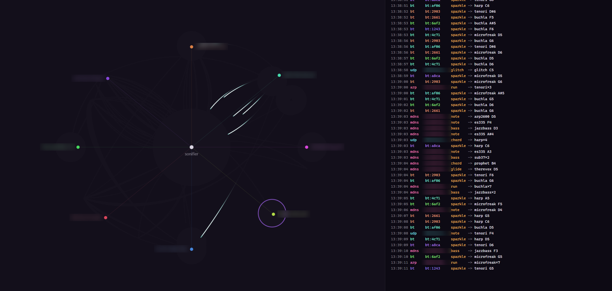
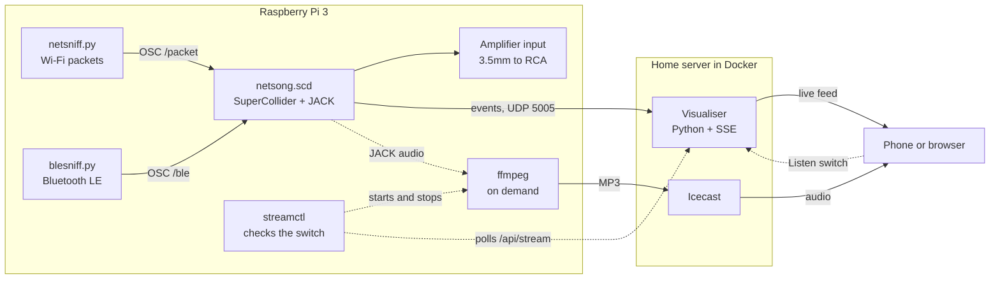

# Sonifier

A Raspberry Pi that listens to my home network and plays it as generative electronic music. Every packet and every nearby Bluetooth device becomes a sound.



## What it does

- Listens to Wi-Fi traffic on the Pi (packet type, size and sender only, never contents) and to Bluetooth LE adverts
- Turns each one into a note, played by an imaginary studio built in SuperCollider: Buchla, ARP 2600, Oberheim, Moog, Prophet and more, plus real Rhodes and harp samples
- Has no backing track. Every sound is a packet. The network decides when and how much, and chance decides what
- Shows what is happening in a live web visualiser, with a visual view, a log-style CLI view of which packet triggered which instrument, and both side by side
- Streams the Pi's audio to my phone with a **Listen** button, only while I want it, so the Pi isn't encoding audio all day

## Why

I got a new amp and was determined to use every input on it. One of them was Network, but my network streamer was running through Optical 1, which left that input sitting dormant. So I decided to "sonify" my network as a little project, and this is the result. Everyone asks "Why?" and my answer is always "Why not?"

Once I'd decided to do it, I wanted it to sound like what I imagined a network would sound like: glitchy and electronic. I looked into the electronic instruments used by some of my favourite artists (Floating Points, Four Tet, Aphex Twin and Bonobo) and landed on the list in [The music](#the-music) below.

## How it works



1. **`netsniff.py`** uses Scapy to read packets on the Pi's Wi-Fi interface. It classifies each one (ARP, mDNS, DNS, DHCP, SSDP, UDP, TCP or HTTPS) and sends SuperCollider an OSC message with the type, size and sender's hardware address.
2. **`blesniff.py`** uses bleak to scan Bluetooth LE adverts. It sends the manufacturer, signal strength and a short anonymous id, at most once every 4 seconds per device.
3. **`netsong.scd`** is the music engine. It gives every event a random instrument, gesture and stereo position, snaps it to a swung 16th-note grid and plays it through JACK to the amplifier.
4. The engine also sends every sound to the **visualiser** as a small UDP event, with the instrument and the moment the sound will actually start, so the animation can land on the beat.

## The music

- **No backing track.** Silence means a quiet house but the nature of Bluetooth means that this will rarely be the case.
- **One shared key.** A ring of related jazzy keys that drifts one step at a time, when a new device joins the network (DHCP) and every so often as time passes. Random notes always come from the current key, so the chaos sounds deliberate.
- **Busy or calm.** A rate estimate sets how busy the network is, which makes the engine more or less glitchy. `NETSONG_BUSY` tunes it.
- **Instruments** are my SuperCollider approximations of gear that inspired them: Buchla, ARP 2600, Oberheim OB-8 and OB-Xa, Yamaha CS-70M and Reface CS, Therevox, Tenori-On, Moog Sub 37, Prophet-6, MicroFreak, a jazz guitar and a jazz bass. Rhodes, harp and percussion are real samples (not included, see below).
- **Gestures:** single notes, calls, runs, chords, glides, sample-and-hold runs, glitches, percussion and basslines.
- **Effects:** a Binson Echorec-style multi-head echo, reverb and some lo-fi glue.
- **Bluetooth sparkles:** signal strength stands for distance. Near devices are loud, bright and dry. Far ones are quiet and washed in reverb. The manufacturer nudges which instrument plays.

## The visualiser

A small Python server (standard library only) in Docker. It receives events over UDP and streams them to the browser with server-sent events.

- **Visuals** draw each device as a node around the sonifier and each sound as a pulse that flies in and lands on the beat. Bluetooth shows as faint sparkles in the background to avoid over congestion.
- **CLI** is a scrolling log of what triggered which instrument.
- **Both** shows the two side by side.
- **Listen** starts the Pi's audio stream and plays it in the page. The visuals are delayed by the measured stream lag so they line up with what you hear, with a trim you can nudge.
- Device names come from a local `devices.json` that maps hardware addresses to names. It is not in this repo.

## Hardware

- Raspberry Pi 3 Model B, running Raspberry Pi OS (64-bit)
- Audio out of the headphone jack via 3.5mm to RCA into an amplifier's network input (a HiFiBerry DAC+ Light is planned)
- A home server (an old desktop running Ubuntu Server) for the visualiser and the audio stream
- A phone for the visualiser and the Listen button

## Tech

| Area | What |
| --- | --- |
| Music engine | SuperCollider (`sclang`) with JACK, 44.1kHz, 512-frame buffer, 0.2s scheduling latency |
| Sniffers | Python 3, Scapy (Wi-Fi) and bleak (Bluetooth LE) |
| Messaging | OSC over UDP on localhost, then UDP to the server |
| Visualiser | Python standard library, server-sent events, vanilla JavaScript on a canvas |
| Audio stream | ffmpeg (JACK input, MP3) into Icecast |
| Services | systemd on the Pi, Docker Compose on the server |

## Repo layout

```
pi/              music engine, sniffers, audio launcher and systemd services
visualiser/      the web visualiser (Docker)
stream/          the Icecast server for the audio stream (Docker)
docs/images/     screenshots
```

## Setup

### On the Pi

1. Install the packages. Names can differ between OS releases:
   ```bash
   sudo apt install -y jackd2 supercollider-language supercollider-server python3-scapy ffmpeg
   ```
   Install `bleak` for the system Python as well, because the services use `/usr/bin/python3`.
2. Allow realtime audio. Put these two lines in `/etc/security/limits.d/audio.conf` and make sure your user is in the `audio` group:
   ```
   @audio - rtprio 95
   @audio - memlock unlimited
   ```
3. Add your own samples in `~/samples`, in folders named `kick snare clap hat ohat ride rim 808 harp rhodes`.
4. Copy the contents of `pi/` to your home folder, rename `netsong.conf.example` to `netsong.conf` and make the launcher executable:
   ```bash
   chmod +x ~/netsong-audio.sh
   ```
5. Install the services, replacing `YOUR_USER` with your username:
   ```bash
   sed -i "s/YOUR_USER/$USER/g" pi/systemd/*.service
   sudo cp pi/systemd/netsong.service pi/systemd/netsniff.service pi/systemd/blesniff.service /etc/systemd/system/
   sudo systemctl daemon-reload && sudo systemctl enable --now netsong netsniff blesniff
   ```

### On the server

```bash
cd visualiser && cp devices.example.json devices.json && docker compose up -d --build
```

Open `http://<server>:8095`. In `pi/netsong.scd` the default destination for events is `192.168.1.10`. Change it with `NETSONG_VIZ` in `netsong.conf`.

### Optional: the audio stream

1. On the server, run Icecast with passwords of your own:
   ```bash
   cd stream && cp .env.example .env && nano .env && docker compose up -d
   ```
2. On the Pi, install the stream files, filling in the Icecast password and the server address in `netsong-stream.service`, and the server address in `netsong-streamctl.sh`:
   ```bash
   sudo cp pi/systemd/netsong-stream.service pi/systemd/netsong-streamctl.service /etc/systemd/system/
   sudo cp pi/netsong-streamctl.sh /usr/local/bin/
   sudo systemctl daemon-reload && sudo systemctl enable --now netsong-streamctl
   ```
   Do not enable `netsong-stream` itself. The checker starts and stops it when you press **Listen**.
3. Open the visualiser and press **Listen**. It takes about 20 seconds to start.

## Configuration

| Setting | Default | What it does |
| --- | --- | --- |
| `NETSONG_BPM` | 124 | Speed of the grid that sounds snap to. It isn't a beat you hear |
| `NETSONG_BUSY` | 2.5 | Higher is calmer. Lower makes the engine react to smaller bursts of traffic |
| `NETSONG_VERBOSE` | 1 | Logs each packet and what it became |
| `NETSONG_DIR` | home folder | Where the `samples` folder lives |
| `NETSONG_VIZ` | 192.168.1.10 | Where visualiser events are sent. `off` disables it |
| `FAKE` (visualiser) | auto | Demo traffic: `auto`, `on` or `off` |

## Problems I hit

- **Crackly audio on a Pi 3.** JACK needed realtime scheduling, a 512-frame buffer and a 0.2 second scheduling latency in SuperCollider.
- **The sonifier hearing itself.** The sniffer picked up the Pi's own traffic to the visualiser and the stream, which made more notes, which made more traffic. It now filters out the project's ports and the Pi's own hardware address, worked out automatically at start-up.
- **Streaming load.** Encoding audio all day is wasted work, so the page has a switch. The Pi polls the server for it (outgoing requests only, no open port on the Pi) and starts or stops the stream to match.
- **Audio lagging the visuals.** The stream arrives a few seconds late. The page measures how far behind the live edge the player is and delays the visuals to match.

## Privacy

- The Wi-Fi sniffer reads **metadata only**: packet type, size and the sender's hardware address. It never reads contents.
- The Bluetooth listener keeps the manufacturer and signal strength. Each device gets a short random id that changes every run and can't be turned back into an address.
- Passwords and device names are not in this repo. Copy the `.example` files and fill in your own.

## Samples and credits

The samples are not included. I used Rhodes and harp samples from SampleSwap and Versilian Studios, and percussion from BVKER's Lunar Lo-Fi pack. Replace them with samples you have the right to use.

Inspired by Floating Points, Four Tet, Aphex Twin and Bonobo. The instrument names refer to hardware that inspired each synth model. The models are my own SuperCollider approximations, with no affiliation to those makers.

## Known limits and next steps

- Built and tested on my own setup only, on a Raspberry Pi 3.
- Planned: a HiFiBerry DAC+ Light for better audio.

## Licence

MIT. See [LICENSE](LICENSE). The libraries and tools this project uses, such as Scapy and SuperCollider, keep their own licences.
